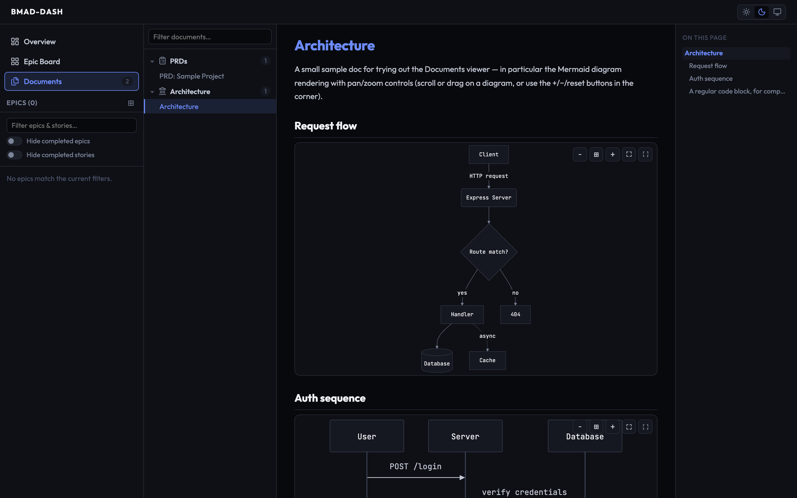
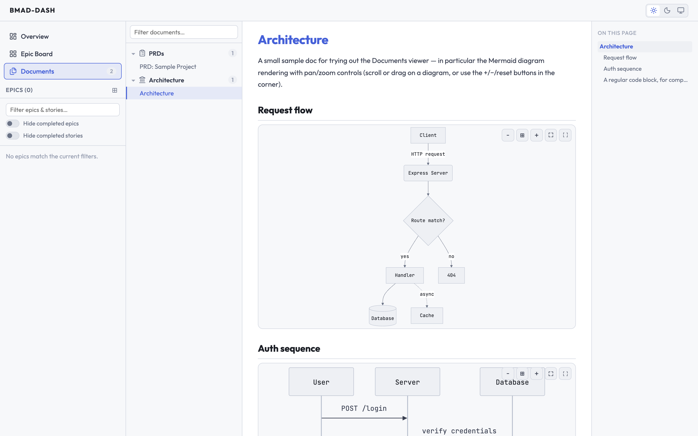

# bmad-dash

*An unofficial, experimental dashboard for the [BMAD Method](https://github.com/bmad-code-org/BMAD-METHOD).*

Visualize BMAD epics, user stories, **and the full set of planning documents** (PRD, architecture, briefs, UX designs, specs, retrospectives, and more) from a project's `.md` files on a localhost dashboard, with **rendered Mermaid diagrams** and a **light / dark / system theme**. Optionally uses local AI (Transformers.js) to match git commits to stories.

[Screenshots](#screenshots)

> `bmad-dash` is a fork of [`bmad-visio`](https://github.com/williammesi/bmad-visio) by William Mesiti, extended with full document visibility, cross-linking, sprint-status integration, filtering, Mermaid diagram rendering, and a light/dark/system theme.

## Quick Start

```bash
npx @melnicorn/bmad-dash
```

Run from your project root. It reads your BMAD install config to locate artifacts, so it works with customized paths:

- **BMAD 6.13+ (ticket tree)** — reads `_bmad/config.toml` (plus the `_bmad/custom/config{,.user}.toml` overlays) for `output_folder` and `active_initiative`, then walks the initiative's `tickets.toml` files. Status comes from each ticket's `*-plan.md`. See [BMAD 6.13+ ticket tree](#bmad-613-ticket-tree).
- **BMAD v6 (classic)** — reads `_bmad/bmm/config.yaml` for `planning_artifacts`, `implementation_artifacts`, and `project_knowledge`; treats `sprint-status.yaml` as the authoritative status source.
- **BMAD v4 / v5** — reads `.bmad-core/core-config.{yaml,yml}` (`docs/stories/`, `docs/prd/`).
- **Fallback** — globs the default `_bmad-output/` layout when no config file is present.

Detection is automatic. To pin it — or to get a clear error instead of an empty
dashboard — pass `--bmad-version`:

```bash
npx @melnicorn/bmad-dash . --bmad-version tickets
```

## Features

- **Three BMAD layouts** — The 6.13+ ticket tree (`tickets.toml` + build plans), classic v6 (`epics.md` + `sprint-status.yaml`), and v4/v5 — detected automatically, or pinned with `--bmad-version`
- **Ticket tree** — Build-order epics and entries, `ref`/risk/hitl/blocked badges, waiting-on prerequisites across epics, and the build plan rendered in-app ([details](#bmad-613-ticket-tree))
- **Next steps** — Tells you what to do next using BMAD's own recommendation ladder (in-progress → review → ready-for-dev → backlog → retrospective), with a copyable workflow command and risk warnings (stale sprint status, orphaned stories, status drift)
- **Epic overview** — Grid of all epics with story counts, status, and progress
- **Epic board** — Project-level Backlog / In Progress / Done board driven by `sprint-status.yaml`, with story rollups and blocking-dependency badges
- **Kanban board** — Stories in 4 columns: To Do → Active → Review → Done
- **Drag & drop** — Move stories or epics between columns; writes status back to the `.md` file **and** `sprint-status.yaml`
- **Story detail** — Acceptance criteria, tasks with checkboxes, progress ring, related commits with a "why did this match?" signal breakdown
- **Documents browser** — Browse and read every BMAD document, grouped by type and initiative, with a table of contents and rendered Markdown — no more opening raw files
- **Mermaid diagrams** — Diagrams in Markdown render inline, with pan/zoom controls (scroll or drag, or +/−/reset buttons) plus expand and fullscreen modes; they follow the active light/dark theme
- **Theme** — Light, dark, or system (follows your OS) — toggle in the top bar, persisted across sessions with no flash on load; code blocks and Mermaid diagrams re-theme to match
- **Cross-linking** — Follow a document's `inputDocuments` graph (upstream inputs and downstream "used by" backlinks), jump from an epic to its dependencies and requirements, and click through internal `.md` links in-app
- **Filtering** — Hide completed epics or stories and text-filter across the sidebar, overview, and boards (persisted across sessions)
- **Traceability** — Epic dependency edges (`Depends on: Epic N`) and the FR Coverage Map parsed from `epics.md`
- **Git commit matching** — Commits naming a story or ticket (`(ticket 3.4)`, `story 1.2`, `#5`) are linked by regex with no dependencies; AI matching is an optional extra for the rest
- **Live editing** — Toggle AC and tasks directly; the dashboard watches the filesystem and updates on change

## Git Commit Matching

Matching runs in two tiers.

**Tier 1 — id references, no dependencies.** A commit whose message names
exactly one known story or ticket is matched outright:

```
Save and resume (ticket 3.4)          → ticket 3.4
Round flow and presentation (ticket 3.2) → ticket 3.2
implement story 1.2                   → story 1.2
fixes #5                              → story 5
```

Candidates are checked against the ids actually in your project, so a version
number like `v1.2` is not mistaken for a story. On a BMAD 6.13+ project whose
builds name their tickets, this alone matches most of the history — no model, no
download, nothing to install.

**Tier 2 — AI matching for everything else.** Opt in by installing the peer
dependency:

```bash
npm install @huggingface/transformers
```

The dashboard will then, for the commits tier 1 did not match:

1. Embed tickets and commits with `bge-small-en-v1.5`
2. Re-rank ambiguous matches with zero-shot NLI (`nli-deberta-v3-small`)
3. Persist mappings in `bmad-dash/gitmap.json` (migrating an existing `bmad-visio/gitmap.json`)
4. Show related commits on each ticket's detail page

First run downloads models locally. Everything runs on-device, no API keys
needed.

> `@huggingface/transformers` is an **optional peer dependency**, not a bundled
> one. It pulls in `onnxruntime-node`, `protobufjs` and `sharp`, whose install
> scripts pnpm 10+ blocks by default — so bundling it would make a plain
> `pnpm install` of `bmad-dash` prompt for build-script approval. Keeping it opt-in
> means a plain install just works, and tier 1 matching still runs. If you do
> install it under pnpm, approve the build scripts with `pnpm approve-builds`
> or add them to `pnpm.onlyBuiltDependencies` in your `package.json`.

## Options

```
npx @melnicorn/bmad-dash [path] [options]

Arguments:
  path                     Project root (default: .)

Options:
  -p, --port <n>           Port number (default: 3334)
  --bmad-version <layout>  BMAD layout to parse (default: auto)
  --no-git                 Skip git commit matching
  --debug                  Dump parsed data as JSON and exit
  -h, --help               Show help
```

### `--bmad-version`

| Value     | Layout                                                                      |
| --------- | --------------------------------------------------------------------------- |
| `auto`    | Detect it: ticket tree → v6 → v5 → v4 → glob fallback **(default)**          |
| `tickets` | BMAD 6.13+ ticket tree (`6.13` and `v6.13` are accepted aliases)             |
| `v6`      | BMAD v6 — `_bmad/bmm/config.yaml`, `epics.md`, `sprint-status.yaml`          |
| `v5`      | BMAD v5 — `.bmad-core/core-config.yaml`                                      |
| `v4`      | BMAD v4 — `.bmad-core/core-config.yml`                                       |

`auto` prefers the ticket tree when a project holds both, which is what a
part-migrated project looks like. An explicit value skips detection entirely and
exits with what it expected and where, rather than showing an empty board:

```
No BMAD "v6" layout found in /path/to/project — expected _bmad/bmm/config.yaml.
Drop --bmad-version to let bmad-dash detect the layout.
```

The layout in use is printed on startup:

```
  Scanning: /path/to/project
  Layout: tickets (BMAD 6.13+ ticket tree) (detected)
  Found 17 epics, 31 tickets
```

## BMAD 6.13+ ticket tree

Newer BMAD releases (the skills-based install, e.g. `method` **6.13.0-next**)
drop `epics.md` and `sprint-status.yaml` for a tree of `tickets.toml` files and
per-ticket build plans:

```
{output_folder}/
  {active_initiative}/                  # e.g. initiative-notes-app/
    initiative-<slug>.md                # type: initiative
    tickets.toml                        # [[epic]] tables — epics in BUILD ORDER
    spec-*/ prd-*/ architecture-*/ ux-*/ research-*/
    epic-<slug>/
      epic-<slug>.md                    # type: epic
      tickets.toml                      # [[entry]] tables — leaves in BUILD ORDER
      <type>-<slug>.md                  # optional, once an entry is "pulled"
      <type>-<slug>-plan.md             # optional build plan — holds the STATUS
  backlog/                              # optional: leaves with no epic
```

Most entries are only rows in `tickets.toml`; a ticket needs no file to exist.
Table order is the build order — **`id` is not**. Try it on the bundled example:

```bash
pnpm dev:tickets          # examples/ticket-project
```

### What the dashboard shows

- **Epic overview / sidebar** — epics in the initiative's build order, with
  ticket counts, derived progress and the `needs` note on each dependency edge.
- **Kanban** — tickets in build order within each column, each card carrying its
  `ref` (`3.4`), type (spike / bug), proposed risk, a **hitl** badge when it needs
  a human step, a **blocked** badge with the reason on hover, and the
  prerequisites it is still **waiting on** — cross-epic `E.N` refs included.
- **Ticket detail** — the entry's description, `verify`, `covers`, notes and
  references; clickable **waits on** / **blocks** lists; and the build plan's
  own metadata (status, route, risk, review, warnings, deferred items). The
  **Plan** tab renders the plan file itself — Intent, Implementation Notes,
  Review Triage Log, Auto Run Result.
- **Documents** — the planning folders under the initiative (`spec-*`, `prd-*`,
  `architecture-*`, `ux-*`, `research-*`), grouped by folder. Ticket files,
  leaf files and plans are excluded, since they are the board's data.
- **Next steps** — what `tickets.py next` reports: ready to start, ready to
  refine, in flight, blocked — with the skill to run (`/bmad-build 3.4`).

### Status mapping

Status lives in the ticket's plan. The derived `state` follows BMAD's own
mapping, and the board column follows from that:

| Plan `status`             | Derived `state` | Board column     |
| ------------------------- | --------------- | ---------------- |
| *no plan at all*          | `planned`       | To Do            |
| `draft`, `ready-for-dev`  | `backlog`       | To Do            |
| `in-progress`, `blocked`  | `in-progress`   | Active           |
| `in-review`, `built`      | `review`        | Ready for Review |
| `done`                    | `done`          | Done             |
| `dropped`                 | `dropped`       | Done, greyed and struck through |

A `blocked` status is flagged separately from the column, with its
`blocked_reason` on the card and in the detail panel. A ticket that has been
*pulled* (its leaf file exists) but has no plan yet reads as `backlog`, not
`planned`. An epic's status is derived from its tickets, so it is not draggable
on the Epic Board.

### Writing status back

Dragging a card writes **only** the `status` field of that ticket's plan
frontmatter, creating a frontmatter-only plan when there is none — exactly what
`tickets.py mark` does:

| Column           | Written status  |
| ---------------- | --------------- |
| To Do            | `ready-for-dev` |
| Active           | `in-progress`   |
| Ready for Review | `in-review`     |
| Done             | `done`          |

`tickets.toml` is never written, and status is never written into a leaf file.
The tree is re-read immediately before each write, so a plan another tool
changed in the meantime is not overwritten from stale state. Acceptance-criteria
and task checkboxes are inert in this layout: a ticket's acceptance lives in its
plan, which the dashboard shows but does not own.

### Fidelity to `tickets.py`

The parser is a port of BMAD's own `_bmad/method/scripts/tickets.py` rather than
a fresh reading of the file format, so no Python or `uv` is needed. Build order,
`after` resolution (sibling ids, cross-epic `E.N`, whole-epic `epic-<slug>`
gates, tracker ids), the `planned`/`backlog` distinction, the ready/blocked
split (a ticket in review satisfies an `after`; an epic gate waits for *done*),
`waiting_on`, `blocks`, the longest remaining chain and the `unpinned_after` /
`undeclared_after` / `order_conflict` checks all match it. Verified row-for-row
against `tickets.py status` and `next` on a real 31-ticket, 17-epic tree.

Plans join their ticket by the frontmatter `ticket:` field, not by slugifying
the title — titles containing characters that slugify away (`Puzzle realisation
for + and −`) still find their plan.

One deliberate difference: where `tickets.py` aborts on a malformed tree,
the dashboard records the problem, drops just that edge or row, and renders the
rest. Problems surface in the startup log and as warnings in the risks panel.

## Status Mapping (v4 / v5 / v6)

| BMAD Status                          | Board Column     |
| ------------------------------------ | ---------------- |
| `backlog`, `ready-for-dev`           | To Do            |
| `in-progress`                        | Active           |
| `review`                             | Ready for Review |
| `done`, `complete`, `cancelled`      | Done             |

Epic and retrospective status come from `sprint-status.yaml` when present.

## Development

```bash
pnpm install
pnpm dev -- /path/to/bmad/project      # tsx, no build step
pnpm dev:tickets                       # the bundled 6.13+ ticket-tree example
pnpm dev:examples                      # the bundled v6 example
pnpm build                             # server (tsc) + client (vite)
pnpm test                              # vitest
```

## License

MIT — see [LICENSE](LICENSE). Originally created by William Mesiti as `bmad-visio`.

## Screenshots

### Overview

The epic overview grid shows all epics with story counts and progress bars at a glance.


### Kanban

The kanban board displays stories across four columns: To Do, Active, Ready for Review, and Done. Stories can be dragged between columns.


### Story Detail View

The story detail view shows acceptance criteria, tasks with checkboxes, a progress ring, and related git commits.


### Documents & Mermaid

The documents browser groups every BMAD document by type and initiative, renders Markdown with a table of contents, and draws Mermaid diagrams inline with pan/zoom, expand, and fullscreen controls.



### Light Theme

Light, dark, and system themes are available from the top-bar toggle and persist across sessions; code blocks and Mermaid diagrams re-theme to match.


