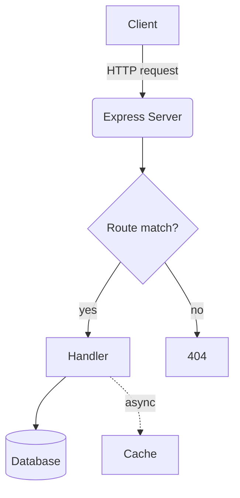
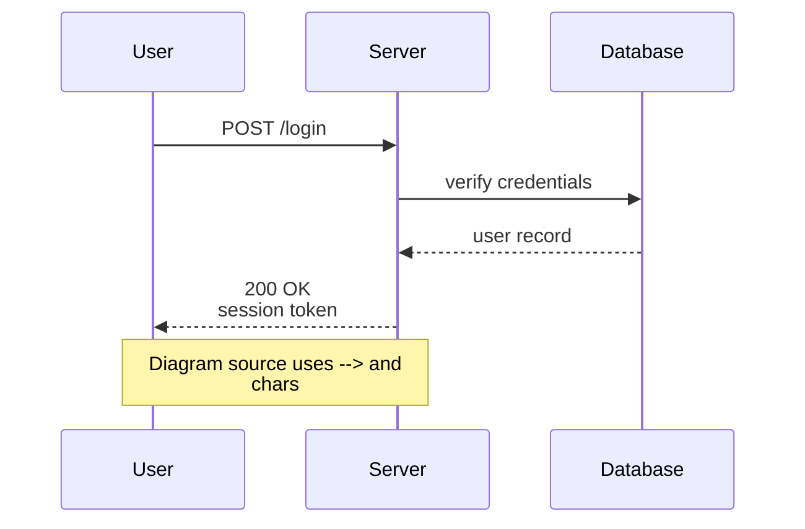

# Architecture

A small sample doc for trying out the Documents viewer — in particular the
Mermaid diagram rendering with pan/zoom controls (scroll or drag on a
diagram, or use the +/−/reset buttons in the corner).

## Request flow



## Auth sequence



## A regular code block, for comparison

```ts
export function add(a: number, b: number): number {
  return a + b
}
```
