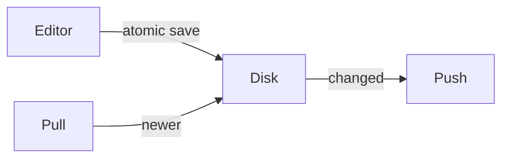

# Notes app architecture

## AD-1 — Saves are atomic

Every write goes to a temp file and is renamed into place. A reader that
finds two slots takes the one with the higher generation that parses.

## AD-2 — Sync is pull-then-push

A device pulls before it pushes, so a conflict is detected locally and
resolved before anything leaves the device.

